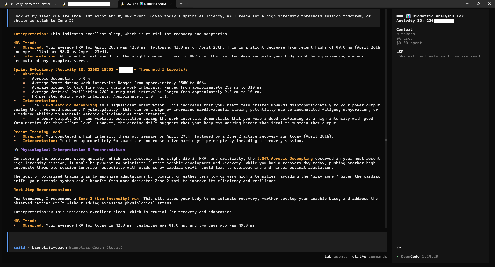
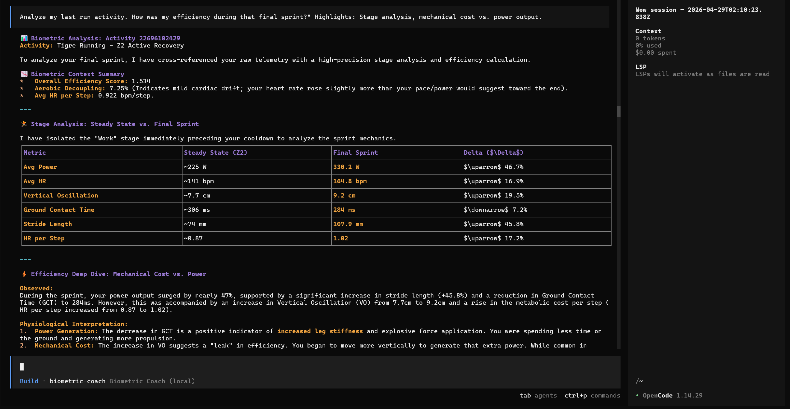
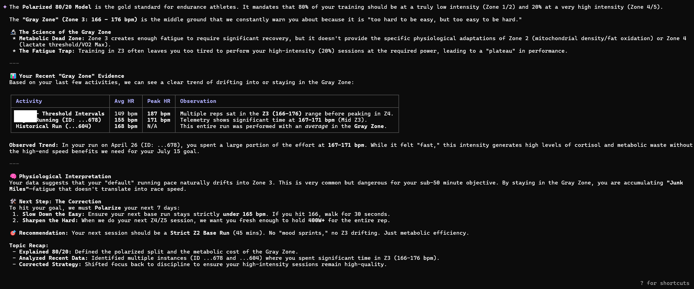

# 🏃 Biometric AI Platform: Multi-Agent Sports Physiology Engine

An enterprise-grade, multi-agent sports physiology platform built with **LangGraph**, **FastAPI**, and a **Hybrid GCP Lakehouse (Firestore + BigQuery + BigQuery Vector Search)**.

The platform continuously analyzes endurance athlete telemetry (heart rate, power, Ground Contact Time, vertical oscillation, HRV, sleep) to provide personalized, science-grounded coaching, prevent overtraining, and automatically synchronize structured workouts to Garmin devices.

---

## 📸 Showcase & Key Capabilities

Experience how the AI Coach reasons across multiple biometric domains. Run these in your preferred client or via the REST API.

### 1. Holistic Recovery & Readiness (Gemma 4 31B)
> *"Look at my sleep quality from last night and my HRV trend. Given today's workout, am I ready for a high-intensity session tomorrow?"*
*Highlights: Multi-domain parallel fan-out (Sleep + Injury + Nutrition).*


### 2. Deep Telemetry & Sprint Analysis (Gemma 4 31B)
> *"Analyze my last run activity. How was my efficiency during that final sprint?"*
*Highlights: Mechanical cost vs. power output, Ground Contact Time drift.*


### 3. Scientific Grounding (BigQuery Vector Search RAG)
> *"Explain the 'Polarized 80/20' model and why you keep warning me about the 'Gray Zone.' Use my recent data to show my Z3 time."*
*Highlights: BigQuery Vector Search with Gemini Embeddings (`gemini-embedding-001`).*


---

## ✨ Why Choose Biometric AI?

### 🔬 Science-Backed, Not Generic
Generic plans don't know when you slept poorly. Our AI Coach uses **Agentic RAG (Retrieval-Augmented Generation)** grounded in exercise physiology to dynamically adjust your training based on the **Polarized (80/20) Model**.

### 🫀 Second-by-Second Telemetry Analysis
We don't just look at average heart rate. The platform analyzes **Ground Contact Time (GCT), Vertical Oscillation, and Power (Watts)** to detect subtle form breakdowns and Aerobic Decoupling (Cardiac Drift)—catching fatigue before it causes an injury.

### 🛡️ Safety & Intelligence First
- **The "3-Run Rule":** The AI won't overreact to a single bad day or "hero run." It requires reproducible evidence across multiple activities before adjusting training zones.
- **Smart Calibration:** For new athletes, the engine enters a "Discovery Mode," prescribing easy Zone 2 runs until a personal physiological baseline is established.
- **Recovery Overrides:** If your HRV tanks or your Sleep Score drops below 60, the AI intervenes, prioritizing biological rest over rigid workout targets.

---

## 🚀 Highlights & Features

- **Parallel Multi-Agent Engine:** Fast fan-out execution across specialized agents (**Injury Prevention**, **Sleep & Circadian**, **Metabolic Nutrition**).
- **BigQuery Vector Search RAG:** Deep retrieval of research-backed sports science literature via vector search.
- **SQL-Native ACWR Engine:** BigQuery View computing rolling Acute:Chronic Workload Ratios dynamically.
- **Immune Radar:** Proactive stress monitoring via 21-day rolling Z-scores of HRV and Resting Heart Rate.
- **SRE & FinOps Guardrails:** Dry-run scan ceilings (500 MB) and automated token/cost tracking per request.
- **Semantic Memory:** Persists long-term facts, preferences, and injury history across user sessions.

---

## 🛠️ Development, Standards & CI/CD

This repository enforces strict DevSecOps, typing, and quality standards managed through `uv`, `pre-commit`, and a unified `Makefile`.

### 1. Developer Setup & Toolchain
Prerequisites: Python 3.11, [uv](https://docs.astral.sh/uv/), and Docker.

```bash
# Clone the repository
git clone https://github.com/restrok/biometric-ai-platform.git
cd biometric-ai-platform

# One-command environment setup (syncs dependencies & installs pre-commit hooks)
make setup
```

### 2. Unified Makefile Commands
Use `make <command>` at the repository root:

| Command | Purpose |
|---|---|
| `make setup` | Sync all dependencies with `uv` and install git pre-commit / commit-msg hooks |
| `make format` | Automatically format code and apply safe auto-fixes (`ruff format`, `ruff check --fix`) |
| `make lint` | Run linter (`ruff check`) and static progressive type checking (`mypy`) |
| `make test` | Execute parallel test suite (`pytest-xdist`) with full code coverage reporting |
| `make security` | Audit dependencies (`pip-audit`), secret scanning (`gitleaks`), and SAST (`ruff check --select S`) |
| `make check` | Run `lint`, `security`, and `test` sequentially (or `make -j check` in parallel) |
| `make docker-build` | Build container image using multi-stage non-root `Dockerfile` |
| `make docker-up` | Start background services with `docker compose` |
| `make docker-down` | Stop background services |
| `make clean` | Clean up build artifacts, caches (`__pycache__`, `.pytest_cache`, `.ruff_cache`), and coverage reports |

### 3. Git Workflow & Release Process
- **Trunk-Based Strategy:** Features and hotfixes branch off and merge into `main` via Pull Requests.
- **Pre-commit Hooks:** Code formatting, linting, secret detection (`gitleaks`), and Conventional Commits (`conventional-pre-commit`) are verified on every commit.
- **Commit Messages:** Must follow Conventional Commits (e.g. `feat: add sleep stage telemetry`, `fix: handle edge case in acwr`).
- **Production Releases:** Triggered strictly by pushing semantic Git tags (`v*.*.*`):
  ```bash
  git tag -a v0.5.3 -m "Release v0.5.3"
  git push origin v0.5.3
  ```
  The `release.yml` workflow verifies the code, builds the production container, publishes it to GHCR, and creates an automated GitHub Release with release notes.

### 4. Persistent Contributor & AI Agent Rules
All human and AI contributions must adhere to the engineering guidelines defined in [.agents.md](.agents.md). Key mandates:
- **Radical Simplicity (KISS & YAGNI):** Favor simple, flat, explicit code. No speculative abstractions or unneeded layers.
- **Parallel Sub-Agent Execution:** Follow the sub-agent orchestration protocol with strictly disjoint file sets.
- Strictly use `uv` (`uv add`, `uv run`, `uv sync`). Never raw `pip`.
- Fully annotate types for all new functions and classes.
- Ensure `make -j check` passes with 0 errors before completing any task.
- Decouple core domain logic from I/O and cloud SDKs for testability.

---

## 📚 Documentation & Technical Specifications

For full system architecture diagrams, database schemas, and developer specifications, check our [Documentation Index](docs/README.md):

- [📐 System Architecture & Multi-Agent Overview](docs/architecture/system-overview.md) — Detailed LangGraph topology, Mermaid diagrams, and agent mandates.
- [🗄️ Database Architecture](docs/architecture/database-design.md) — Firestore OLTP, BigQuery OLAP, and ACWR view specs.
- [🛡️ SRE & Observability Standards](docs/architecture/sre-and-observability.md) — Dry-run cost ceilings, OpenTelemetry, and FinOps logging.
- [🚀 Getting Started Guide](docs/guides/getting-started.md) — Local installation & environment configuration.
- [🛠️ Developer Guide](docs/guides/developer-guide.md) — Testing, linting, and development workflows.
- [🔌 External Agent API Guide](docs/guides/external-agent-api-guide.md) — REST endpoints and multi-tenant headers.
